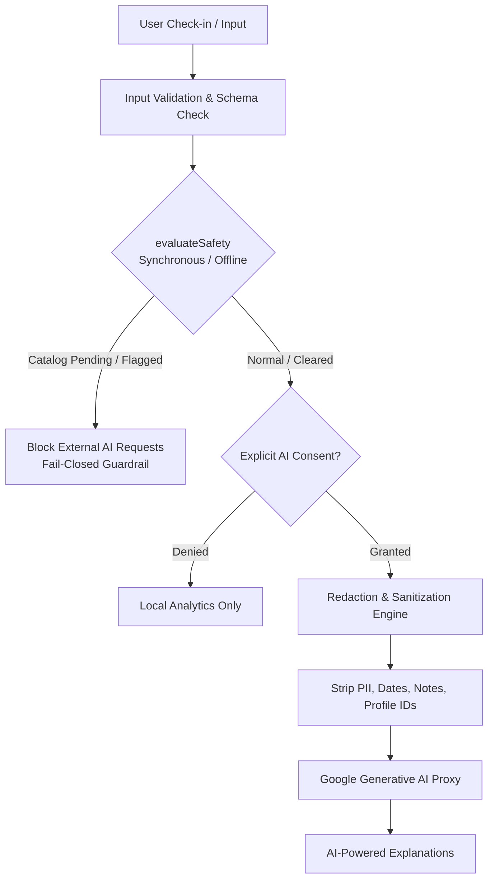

# FEMORA — Privacy-First Women's Health Platform

> **Care for Every Phase of Her Life.**  
> A local-first, privacy-first progressive web platform for **Menstrual Health**, **Maternity & Postpartum**, and the **Menopause Transition**. Built with React 18, TypeScript, IndexedDB (Dexie), client-side AES-GCM encryption, deterministic clinical safety guardrails, and verified educational resources.

---

## 🌟 Overview & Core Principles

FEMORA is engineered to give women absolute sovereignty over their intimate health data. Unlike conventional digital health trackers that monetize personal telemetry, FEMORA operates **local-first**: all cycle logs, pregnancy milestones, menopause symptoms, and clinical notes reside in an encrypted database directly on the user's device.

### Core Architecture Principles:
1. **Zero-Knowledge by Default**: Sensitive health observations are encrypted at rest with AES-GCM (256-bit) and authenticated keys derived via PBKDF2 (310,000 iterations). Raw health records are never broadcast to remote cloud servers without explicit user intent.
2. **Fail-Closed Clinical Safety**: Safety evaluations execute deterministically, offline, and synchronously. Any unreviewed safety rule or missing clearance fails closed (`review_pending`), preventing premature or automated medical clearance.
3. **Privacy-Preserving AI Gateway**: Automated summaries and AI-assisted insights strictly strip all PII, exact timestamps, profile IDs, and subjective user notes. AI payloads require explicit user consent and are blocked if clinical safety evaluation is pending or triggered.
4. **Transparent Data Portability**: Users can export encrypted backups (`femora-backup-v1`) with PIN recovery, migrate across devices, or permanently wipe all records in an atomic transaction.

---

## 🧭 The Three Health Journeys

FEMORA provides tailored interfaces, tracking parameters, and evidence-based insights across three distinct reproductive and hormonal phases:

### 1. Menstrual Health
- **Cycle Tracking & Estimation**: Period start/end logging, flow intensity, and period regularity analytics.
- **Phase Heuristics**: Estimated follicular, ovulatory, and luteal phases based on standardized ACOG interval rules.
- **Symptom Logging**: Pelvic cramping, fatigue, mood shifts, headache, and bloating tracking with severity scales.
- **Sexual Wellbeing (18+)**: Optional, gated educational module for consensual intimacy, libido tracking, and questions for care providers.
- **Menstrual Health Report**: Summary reports ready for gynecological visits with cycle metrics, symptom frequency distributions, and PDF export.

### 2. Maternity & Postpartum Care
- **Gestational Milestones**: LMP-derived estimated due dates (280 calendar days UTC) and trimester tracking (Trimester 1: weeks 1–13, Trimester 2: weeks 14–27, Trimester 3: weeks 28+).
- **Fetal Movement & Kick Counter**: Daily kick-counting sessions with physiological frequency tracking.
- **Birth Plan Builder**: Structured preferences covering labor environment, pain relief options, delivery positions, and newborn postpartum procedures (delayed cord clamping, skin-to-skin).
- **Hospital Bag Readiness**: Interactive checklists for mother, baby, and birth partner.
- **Postpartum Healing**: Physical recovery logs (lochia, perineal healing, cesarean incision checks), emotional health screenings (Baby Blues vs. PPD), and 2-week/6-week appointment prep.
- **Maternity Report**: Clinical summaries of gestational progress, vitals, and birth preferences.

### 3. Menopause Transition
- **STRAW+10 Transition Tracking**: Support for Perimenopause (early/late transition), Menopause, and Postmenopause tracking without crude age-based assumptions.
- **Vasomotor Episodes**: Tracking hot flash frequency, night sweats, duration, and severity triggers.
- **Sleep Quality & Cognitive Trends**: Sleep latency, nocturnal awakenings, and brain fog patterns.
- **Menopause Care & HRT Preparation**: Evidence-based hormone replacement therapy (HRT) discussion guides and bone/cardiovascular lifestyle checklists.
- **Menopause Health Report**: Formatted summaries of vasomotor trends and sleep disruption rates for primary care and gynecological consultations.

---

## 🔒 Security, Vault Cryptography & Profile Isolation

FEMORA implements defense-in-depth security directly within the browser runtime:

```
[ User PIN (4–6 digits) ]
           │
           ▼
[ PBKDF2-HMAC-SHA-256 (310,000 iterations + 16-byte random salt) ]
           │
           ▼
[ HKDF Key Derivation ]
    ├──► pinCheck (HMAC verification key)
    └──► wrappingKey (AES-KW / AES-GCM wrapping)
           │
           ▼
[ Unwraps 256-bit AES-GCM Data Key ]
           │
           ▼
[ Encrypts / Decrypts IndexedDB Sensitive Health Records ]
```

- **Cryptographic Algorithms**: Web Cryptography API (`SubtleCrypto`) utilizing AES-GCM (256-bit) with 12-byte IVs and authenticated additional data (AAD) binding record IDs and timestamps.
- **No Plaintext PIN Storage**: The database stores only the salt, iteration count, verification hash, and wrapped-key envelope. Plaintext PINs and raw keys never hit disk.
- **Multi-Profile Isolation**: Support for multiple profiles with strict transactional boundaries. Active profile switching increments session revision counters and purges the previous profile's crypto keys from memory.
- **Automatic Inactivity Timeout**: Vault sessions automatically expire and lock after 10 minutes of inactivity.
- **Cross-Tab Invalidation**: `BroadcastChannel` (with fallback to `localStorage` storage events) invalidates and locks vault sessions across all open browser tabs when a profile is locked or switched.

---

## 🛡️ Clinical Safety & AI Safeguards

FEMORA adheres to rigorous biomedical and clinical safety standards:



- **Fail-Closed Evaluator**: The safety engine (`src/core/safety.ts`) executes synchronously without network reliance. If clinical rules are unreviewed or unavailable, it explicitly marks the evaluation as `review_pending` and triggers safe fail-closed routing.
- **No Diagnostic Claims**: FEMORA provides observational tracking and educational assistance. It explicitly avoids automated clinical verifications or treatment prescriptions.
- **Zero-Exposure AI Payload Builder**: Before any query is dispatched to the AI proxy (`@google/generative-ai`), `buildAiPayload` verifies explicit consent, re-evaluates safety status, and strips all names, notes, raw dates, and profile identifiers.

---

## 📚 Educational Library & Clinically Sourced Content

FEMORA includes an offline-capable educational repository of **21 reviewed articles** (`src/content/data.ts`):
- **Citations & Standards**: Grounded in published clinical guidelines from the **World Health Organization (WHO)**, **American College of Obstetricians and Gynecologists (ACOG)**, **National Institute for Health and Care Excellence (NICE)**, and the **National Health Service (NHS)**.
- **Interactive Markdown Viewer**: Full reader support for structured headings, clinical callouts, practical takeaways, and questions to ask clinicians.
- **Search & Categorization**: Instant client-side search powered by `minisearch` with filtering by reproductive journey.

---

## 📊 Health Reports & PDF Generation

Each journey features comprehensive health reports powered by [`@react-pdf/renderer`](https://react-pdf.org/):
- **Executive Metric Summaries**: Regularity indices, gestational milestones, vasomotor frequencies, and appointment histories.
- **Symptom Analytics**: Interactive frequency bars, severity trends, and contextual observations.
- **Demo Mode Transparency**: When sample data is displayed, persistent alert banners clearly state that data is illustrative to prevent confusing synthetic figures with actual clinical findings.
- **One-Click Clinical Export**: Generates clean, printer-friendly PDFs formatted specifically for clinical consultations.

---

## 🗄️ Database Architecture & Storage Schema

Data is managed locally via **Dexie** across 11 relational IndexedDB object stores:

| Table | Description | Compound Indexing & Isolation |
|---|---|---|
| `profiles` | Multi-profile accounts and nicknames | `id, createdAt, updatedAt` |
| `healthProfile` | Baseline vitals, medical history, cycle metadata | `profileId, updatedAt` |
| `journeyProfiles` | Journey-specific settings and active phases | `[profileId+journey], updatedAt` |
| `checkins` | Daily symptom, mood, and flow observations | `[profileId+journey+loggedAt], [profileId+date]` |
| `records` | Clinical milestones, lab tests, treatment logs | `[profileId+journey+type], [profileId+date]` |
| `appointments` | Prenatal, annual, and follow-up medical visits | `[profileId+scheduledAt], [profileId+journey]` |
| `notifications` | Local scheduled reminders and medication alerts | `[profileId+scheduledFor], [profileId+read]` |
| `bookmarks` | Saved learning resources and educational topics | `[profileId+topicId], createdAt` |
| `recentlyViewed` | Recent article reading history | `[profileId+viewedAt]` |
| `consents` | Fine-grained telemetry and AI consent records | `[profileId+scope], grantedAt` |
| `settings` | Vault cryptographic envelopes and preferences | `profileId, updatedAt` |

---

## 📁 Repository Structure

```
FEMORA/
├── docs/                               # Architectural specs, schema references & audit logs
│   ├── BACKEND_SCHEMA_REFERENCE.md     # Dexie v1–v4 schemas & migration rules
│   ├── CORE_ENGINE.md                  # Core Engine specifications & vault security
│   ├── INTEGRATION_CONTRACT.md         # Public API contracts & result types
│   └── FEMORA-Clinical-Review-Gap-Register.md # Safety rule catalog audits
├── src/
│   ├── app/                            # Application entry, router, and context providers
│   │   ├── App.tsx                     # Main routes & protected journey gates
│   │   └── providers.tsx               # AppProviders, active profile & vault state
│   ├── content/                        # Clinically referenced educational library
│   │   ├── data.ts                     # 21 reviewed topic guides (WHO, ACOG, NHS)
│   │   └── search.ts                   # MiniSearch full-text indexing engine
│   ├── core/                           # Local-first Core Engine
│   │   ├── backup/                     # Encrypted export/restore with rollback & wipe
│   │   ├── contracts.ts                # Runtime Zod schemas & typed Result<T> contracts
│   │   ├── safety.ts                   # Deterministic, offline safety evaluator
│   │   └── journeys.ts                 # Menstrual, maternity, & menopause logic
│   ├── crypto/                         # Web Crypto AES-GCM & PBKDF2 vault
│   │   └── vault.ts                    # Key wrapping, session invalidation, & auto-lock
│   ├── data/                           # Persistence boundary
│   │   ├── access.ts                   # Low-level Dexie IndexedDB adapter
│   │   ├── fakeDatasets.ts             # Realistic sample demographic & symptom data
│   │   └── public.ts                   # High-level public coreApi client
│   ├── pages/                          # Application screens and journey views
│   │   ├── LearnPage.tsx               # Interactive learning hub & markdown reader
│   │   ├── menstrual/                  # Menstrual dashboard, cycle, reports & wellbeing
│   │   ├── maternity/                  # Maternity dashboard, checklists, kick-counter & reports
│   │   └── menopause/                  # Menopause dashboard, insights, care & reports
│   ├── reports/                        # Report aggregation & PDF generation
│   │   ├── reportBuilder.ts            # Aggregate health statistics & trends
│   │   ├── ReportPreviewView.tsx       # Interactive in-app report viewer
│   │   └── ReportPdfDocument.tsx       # @react-pdf/renderer document definition
│   └── styles/                         # CSS design system (tokens, themes, visual polish)
├── tests/                              # Comprehensive Vitest automated test suite
│   ├── core.test.ts                    # Vault crypto, migrations, & profile isolation
│   ├── reports.test.ts                 # Health report aggregation & sample fallback
│   ├── rapid_core_engine_integration.test.ts # End-to-end integration flows
│   └── fake_datasets_and_api.test.ts   # Core API and dataset verification
├── package.json                        # Project dependencies and script runner
├── tsconfig.json                       # TypeScript compiler configuration
└── vite.config.ts                      # Vite build & bundler configuration
```

---

## 🚀 Getting Started

### Prerequisites
- **Node.js**: v18.0.0 or later
- **npm**: v9.0.0 or later

### Installation
```bash
# Clone the repository
git clone https://github.com/your-org/femora.git
cd femora

# Install dependencies
npm install
```

### Local Development Server
```bash
# Start local development server with Hot Module Replacement (HMR)
npm run dev
```
Navigate to `http://localhost:5173` in your browser.

---

## 🧪 Testing & Code Quality

FEMORA maintains a comprehensive testing regime verifying cryptography, database migrations, clinical safety fallbacks, and UI flows:

```bash
# Run TypeScript compilation check
npm run typecheck

# Run full Vitest automated test suite (136 tests)
npm test

# Run ESLint for structural & architectural rules
npm run lint

# Build production bundle with Vite & TypeScript
npm run build
```

### Test Suite Highlights:
- **`tests/core.test.ts`**: PIN-protected vault encryption, PBKDF2 key derivation, cross-tab session invalidation, transactional wipe, and Dexie migrations.
- **`tests/reports.test.ts`**: Report data aggregation, symptom frequency calculations, and PDF export validation.
- **`tests/rapid_core_engine_integration.test.ts`**: End-to-end user actions across Menstrual, Maternity, and Menopause journeys.
- **`tests/ai.test.ts`**: Fail-closed AI safety boundaries, redaction filters, and consent gating.

---

## ⚖️ Clinical & Legal Disclaimers

> **Medical Disclaimer**: FEMORA is an informational health tracking and educational platform. It does not provide medical diagnoses, clinical verdicts, treatment plans, or emergency triage. Always consult a certified gynecologist, obstetrician, midwife, or qualified healthcare professional regarding any medical concerns. In an emergency, contact your local emergency services immediately.

> **Privacy Notice**: Health data stored within FEMORA is encrypted locally on the device using standard Web Cryptography APIs. Exported unencrypted backups or shared health reports are the sole responsibility of the user.

---

## 📄 License

This project is licensed under the terms of the private/internal organizational license. See [Terms of Use](src/pages/legal/TermsPage.tsx) and [Privacy Policy](src/pages/legal/PrivacyPolicyPage.tsx) for details.
