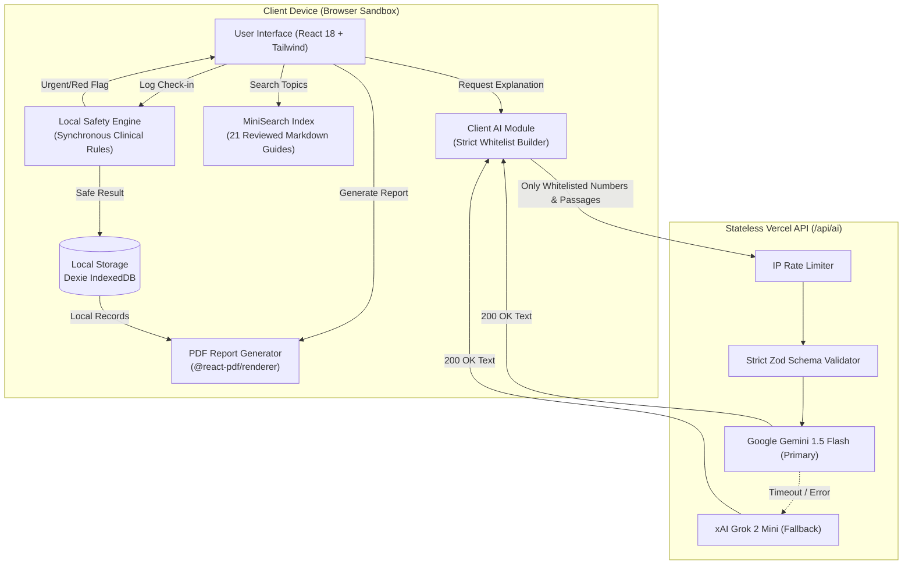

# FEMORA — Technical Architecture

## 1. System Overview
FEMORA is designed as a **local-first progressive web application** paired with a **stateless, privacy-preserving AI proxy**.
All personal health tracking records, notes, appointments, and credentials are kept strictly in the client's browser (IndexedDB via Dexie). No user accounts or central databases exist on the server.

---

## 2. Core Subsystems

### A. AI Integration & Serverless Fallback Proxy (`api/ai.ts`, `src/ai/`)
1. **Client Allowlist Enforcement:** Only `buildAiPayload()` is permitted to construct payloads for external transmission. It extracts:
   - Life stage `journey`: `menstrual | maternity | menopause`
   - Relative `window`: e.g. "last 3 cycles", "last 4 weeks"
   - Aggregate `metrics`: approved numeric metrics only (e.g. `cycleLengthAvg`, `painScoreAvg`)
   - Approved `symptomIds`: sanitized enum tags (e.g. `cramps`, `fatigue`)
   - `contentPassages`: IDs and text of retrieved, clinically reviewed educational passages.
2. **Serverless Proxy:**
   - Stateless Vercel serverless function (`/api/ai`).
   - Rate limits each client IP (default: 20 requests/minute).
   - Validates JSON against `AiPayloadSchema.strict()`; any unexpected or unapproved fields are rejected with HTTP 400.
   - Primary provider: Google Gemini (`AI_PRIMARY_MODEL`).
   - Secondary provider: xAI Grok (`AI_FALLBACK_MODEL`), called via OpenAI-compatible endpoint if Gemini errors, times out (`AI_TIMEOUT_MS`), or is rate limited.
   - Output tokens capped by `AI_MAX_TOKENS`.
   - No request body or generated text logging.
3. **On-Device Rule-Based Fallback:**
   - If AI is disabled, consent is missing, the device is offline, or both providers return 502, the app falls back to `generateLocalRuleBasedExplanation()` on the client.

### B. Medical Content Library & MiniSearch Retrieval (`content/`, `src/content/`)
- 21 structured Markdown topics organized across Menstrual, Maternity, and Menopause journeys.
- Front matter schema: `id`, `title`, `journey`, `sources`, `reviewStatus`.
- Sources cite verified institutional guidelines (WHO, NHS, ACOG, NICE, BMS).
- Content marked as `pending` is visibly distinguished and strictly filtered out of AI grounding passages.
- In-browser keyword search powered by `MiniSearch` with BM25-style relevance scoring.

### C. PDF Report Engine (`src/reports/`)
- Powered by `@react-pdf/renderer`.
- Builds three specialized reports:
  1. *Menstrual Health Consultation Summary*
  2. *Maternity & Postpartum Care Summary*
  3. *Menopause & Transition Health Report*
- Generates locally on-device directly into a `Blob`.
- Features date range filtering, executive metrics, symptom frequency tables, optional notes, and mandatory clinical disclaimers.
- Sexual Wellbeing data is excluded by default and included only upon explicit dual confirmation.
- Direct download and Web Share API fallback.

### D. In-App Notifications (`src/data/notifications.ts`)
- Evaluates locally saved appointments on app startup.
- Generates in-app reminders without background schedulers, push services, SMS, or external servers.
- Deduplicates reminders and ignores completed or cancelled appointments.
- Messages contain generic scheduling keys, never sensitive medical notes.
